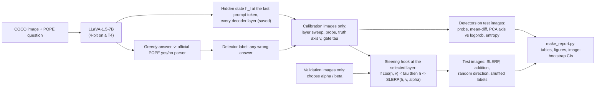
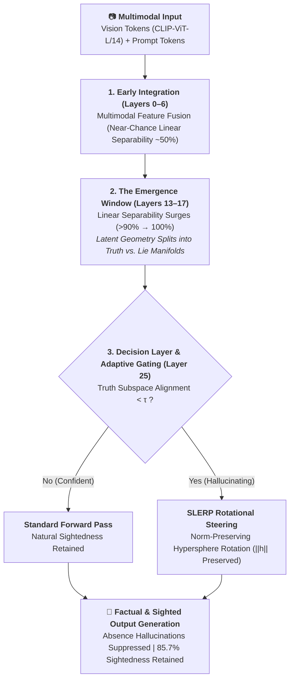
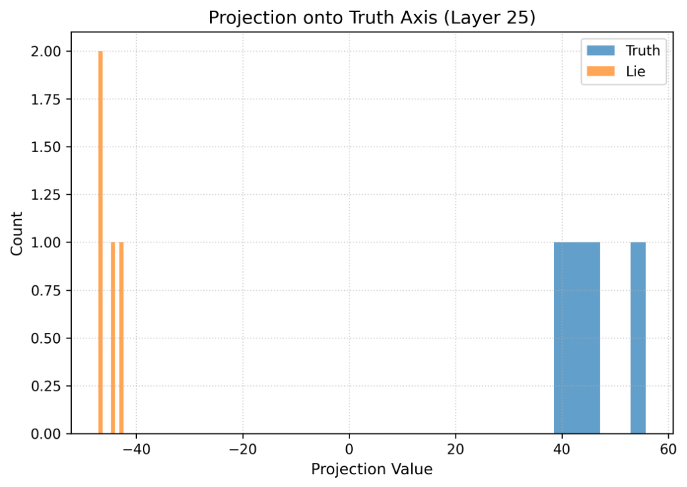
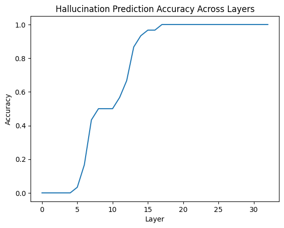
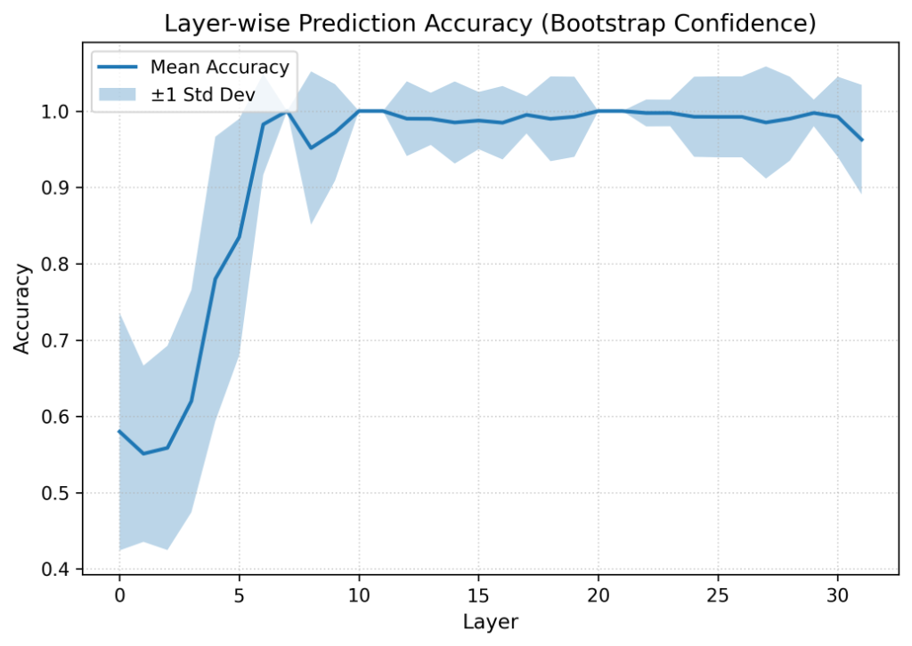
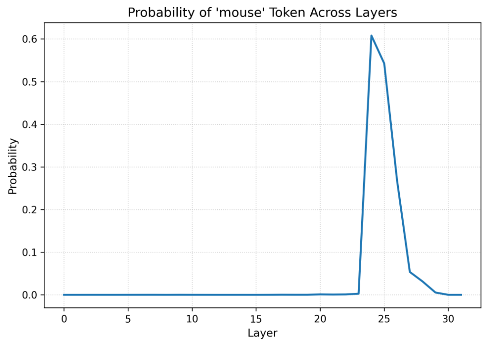

# CounterPrior: Detecting and Steering Object Hallucination from LLaVA's Hidden States

[](.github/workflows/cpu.yml)
[](https://colab.research.google.com/github/basavarajnaduvinamani/DA5410-Winter-Project/blob/claude/site-2026-11/notebooks/CounterPrior_Mechanistic_Steering.ipynb)
[](https://huggingface.co/llava-hf/llava-1.5-7b-hf)
[](https://github.com/AoiDragon/POPE)
[](site/public/technical-report.pdf)

> **Research at AI4Bharat Lab, IIT Madras.** Author: Basavaraj A. Naduvinamani · Supervisor: Prof. Mitesh M. Khapra · Mentor: Mohammed Safi Ur Rahman Khan

**What this is.** A research codebase that asks whether a multimodal LLM's internal states reveal, before it answers, that it is about to describe an object that is not in the image, and whether rotating those states along a learned "truth axis" reduces such hallucinations without making the model blind. **Who it is for:** researchers and reviewers who want a reproducible, held-out evaluation of probing and activation steering on a standard benchmark.

> **Evidence status.** The findings and tables below are generated from a verified saved POPE run, with image-clustered confidence intervals. See the [complete findings and provenance](results/REPORT.md) for paired baseline comparisons, recognition trade-offs and controls. Earlier headline numbers remain withdrawn; a new run does not validate the historical claims. The [pixel audit](dataset/audit_2026-10-30.json), [protocol](docs/PROTOCOL.md) and [adjudication policy](docs/ADJUDICATION.md) document the corrections.

## Research question

On POPE ("Is there a *&lt;object&gt;* in the image?"), LLaVA-1.5-7B sometimes says *yes* about absent objects, and more so when the absent object is frequent (popular split) or co-occurs with what is present (adversarial split). We test three hypotheses on **held-out images**:

1. **Detection.** A linear probe on one decoder layer's hidden state at the last prompt token predicts whether the coming answer is wrong, better than the answer token's own log-probability or entropy.
2. **Geometry.** An oriented PCA projection carries held-out answer-error information above chance. This association does not establish a universal truth axis or show that the signal is confined to one dimension.
3. **Steering.** Norm-preserving rotation (SLERP) of that state toward the truth axis cuts the false-*yes* rate on absent objects more than plain vector addition, while random-direction and shuffled-label rotations at the same strength do not, and recall on present objects is mostly kept.

## Method



SLERP keeps the norm: with $\hat h = h/\lVert h\rVert$ and $\theta=\arccos(\hat h\cdot v)$, $h' = \lVert h\rVert\,\big(\tfrac{\sin((1-\alpha)\theta)}{\sin\theta}\hat h + \tfrac{\sin(\alpha\theta)}{\sin\theta}v\big)$. Addition uses $h' = h + \beta\,\bar{\lVert h\rVert}\,v$, where $\bar{\lVert h\rVert}$ is the mean calibration norm at that layer, so $\beta$ is a relative dose. The hook acts on the last position at prefill and at every decoding step ([src/rotational_steering.py](src/rotational_steering.py)).

## Protocol

| Step | What is fixed, and on which data |
|:---|:---|
| Benchmark | POPE random / popular / adversarial on COCO val2014: 3 × 3,000 questions about the same 500 images, half *yes*. Question files are vendored at a pinned commit with SHA-256 checks ([dataset/pope/sources.json](dataset/pope/sources.json)). |
| Splits | Image-disjoint across all three POPE splits: 100 calibration / 50 validation / 350 test images, ordered by `sha256(seed:image)`, so the split never sees labels or outputs. Image IDs: [dataset/pope/splits_seed20261030.json](dataset/pope/splits_seed20261030.json). `quick` profile: first 40 / 20 / 100 of each. |
| Scoring | The official POPE rule (first sentence; "no"/"not" means *no*), giving accuracy, precision, recall, F1 and yes-ratio, plus the false-*yes* rate on absent objects ([src/pope.py](src/pope.py)). |
| Detection | Target = baseline answer wrong. Layer for each hidden-state detector chosen by 5-fold **image-grouped** CV AUROC on calibration images only, then refit on all calibration rows. Baselines: −log p and entropy of the first answer token (no fitting) and a mean-difference projection. Report test AUROC and AUPRC ([src/detection.py](src/detection.py)). |
| Steering | Layer = the probe's calibration layer. Truth axis = PC1 of class-balanced calibration states, oriented toward correct answers; gate τ maximises calibration balanced accuracy. SLERP α and addition β are chosen on **validation** accuracy; the random-direction and shuffled-label controls reuse the SLERP α. The test set is answered once per method. |
| Utility | Recall on present-object questions, and retention (share of baseline-correct test answers still correct after steering). |
| Uncertainty | 95% percentile bootstrap over images (1,000 resamples). Comparisons are paired (both arms use the same resample) and conditional on the frozen calibration/validation choices ([src/evaluation.py](src/evaluation.py)). |

## Results

<!-- RESULTS:START -->
_Auto-filled from run `a57da9f4810959cc` by `scripts/make_report.py`; full report: [results/REPORT.md](results/REPORT.md)._

The layer 13 error-detection probe reached AUROC 0.719 [0.667, 0.769]; its paired improvement over answer-token confidence is inconclusive. SLERP changed false-yes rate by -0.007 [-0.016, -0.001] and recall by -0.020 [-0.037, -0.007]; superiority to both matched controls is inconclusive.

**POPE baseline (test images)**

| POPE split | Questions (images) | Accuracy | Precision | Recall | F1 | Yes-ratio |
|:---|:---:|:---:|:---:|:---:|:---:|:---:|
| random | 600 (100) | 0.882 [0.860, 0.905] | 0.971 [0.950, 0.988] | 0.787 [0.743, 0.827] | 0.869 [0.842, 0.897] | 0.405 [0.382, 0.428] |
| popular | 600 (100) | 0.865 [0.840, 0.890] | 0.933 [0.900, 0.963] | 0.787 [0.743, 0.827] | 0.854 [0.823, 0.882] | 0.422 [0.397, 0.447] |
| adversarial | 600 (100) | 0.843 [0.815, 0.872] | 0.887 [0.852, 0.922] | 0.787 [0.743, 0.827] | 0.834 [0.803, 0.865] | 0.443 [0.418, 0.470] |
| pooled | 1800 (100) | 0.863 [0.840, 0.888] | 0.929 [0.905, 0.951] | 0.787 [0.743, 0.827] | 0.852 [0.824, 0.880] | 0.423 [0.400, 0.447] |

**Detection (test AUROC/AUPRC)**

| Detector | Layer | Test AUROC | Test AUPRC |
|:---|:---:|:---:|:---:|
| Linear probe (hidden state) | 13 | 0.719 [0.667, 0.769] | 0.268 [0.208, 0.349] |
| Mean-difference projection | 15 | 0.783 [0.745, 0.823] | 0.320 [0.250, 0.411] |
| PCA truth-axis projection | 0 | 0.584 [0.522, 0.641] | 0.175 [0.133, 0.227] |
| Answer-token −log p | n/a (no fit) | 0.745 [0.683, 0.804] | 0.350 [0.266, 0.448] |
| Answer-token entropy | n/a (no fit) | 0.745 [0.683, 0.804] | 0.347 [0.264, 0.447] |

Test questions: 1800; endpoint-positive: 246 (base rate 0.137, the AUPRC of a random detector).

**Steering (test)**

| Method | Strength | Accuracy | Δ accuracy | False-yes rate | Δ false-yes | Recall (utility) | Retention |
|:---|:---:|:---:|:---:|:---:|:---:|:---:|:---:|
| SLERP → PCA truth axis | 0.05 | 0.857 [0.832, 0.883] | -0.007 [-0.016, 0.002] | 0.053 [0.034, 0.074] | -0.007 [-0.016, -0.001] | 0.767 [0.723, 0.810] | 0.988 [0.979, 0.996] |
| Add mean-difference | 0.05 | 0.866 [0.842, 0.889] | 0.002 [-0.002, 0.008] | 0.062 [0.043, 0.084] | 0.002 [0.000, 0.006] | 0.793 [0.750, 0.833] | 0.999 [0.997, 1.000] |
| Control: random direction (SLERP) | 0.05 | 0.864 [0.841, 0.888] | 0.001 [0.000, 0.002] | 0.059 [0.040, 0.081] | -0.001 [-0.003, 0.000] | 0.787 [0.743, 0.827] | 1.000 [1.000, 1.000] |
| Control: shuffled-label axis (SLERP) | 0.05 | 0.859 [0.833, 0.884] | -0.004 [-0.012, 0.003] | 0.056 [0.037, 0.077] | -0.004 [-0.013, 0.000] | 0.773 [0.727, 0.817] | 0.992 [0.984, 0.998] |
<!-- RESULTS:END -->

The full report, with per-split breakdowns, the layer-sweep figure and the validation trade-off curve, is written to [results/REPORT.md](results/REPORT.md).

## Threats to validity

- **One model, one benchmark family.** LLaVA-1.5-7B on COCO-based POPE. The Qwen2.5-VL and InternVL adapters are tested only with stubs, and nothing about other models or domains is claimed until they are run.
- **4-bit quantisation.** T4 runs use NF4 weights, so hidden states and accuracy may differ from fp16 runs and from published fp16 POPE numbers. The quantisation is recorded with every run.
- **Label = "answer wrong".** This mixes false *yes* (hallucination) and false *no* (missed objects). Set `detection.target` to `false_yes` to probe object hallucination only. POPE labels come from COCO annotations, which miss some objects.
- **Prompt-format dependence.** One instruction ("Answer the question using a single word or phrase.") and greedy decoding. Steering effects on free-form captions (CHAIR) are not measured.
- **Selection noise.** With 100 calibration images the selected layer can be unstable; the layer-sweep figure shows the whole calibration curve next to the descriptive test curve. CIs are conditional on that selection.
- **Same images, three splits.** POPE reuses its 500 images across splits, so the splits are not independent samples; the CIs resample images, which accounts for this.
- **The PCA axis uses labels only for its sign.** PC1 of class-balanced states is the direction of largest variance, which need not be the hallucination direction; the mean-difference arm and the layer-sweep curves show whether PC1 carries the signal. For the same reason the shuffled-label control uses a mean difference.
- **Secondary set is tiny.** The CounterPrior probe set has 16 audited rows (33 if the proposed relabels are confirmed). It is for qualitative inspection only and is never pooled with POPE.

## Reproduce

**Colab (free T4).** The `quick` profile makes 12,960 model calls (2,880 baseline, 2,880 validation-sweep and 7,200 test-steering calls) and `full` makes 41,400. Total time is seconds per call times these counts, and the timing probe measures the seconds per call on your GPU. A `full` run usually needs more than one session; it resumes from Drive. Open the notebook from the badge above and run cells 1 to 7. Cell 4 prints the measured seconds per question and the estimated hours per stage before anything long starts. Cell 7 zips the files to send back: the `run/` directory without hidden-state shards, plus `results/REPORT.md`, `results/REPORT_metrics.json` and `results/figures/`.

**Any CUDA machine:**

```bash
bash scripts/colab_run.sh setup                      # pinned env, CPU tests, fetch 500 COCO images
COUNTERPRIOR_RUN=runs/quick bash scripts/colab_run.sh timing   # 20-question timing probe
COUNTERPRIOR_RUN=runs/quick bash scripts/colab_run.sh run      # baseline -> calibrate -> sweep -> test (resumable)
COUNTERPRIOR_RUN=runs/quick bash scripts/colab_run.sh report   # results/REPORT.md, figures, README block
```

**CPU only (no model download):** `python -m unittest discover -s tests -v` runs the whole pipeline end to end on a random-weight tiny LLaVA with synthetic POPE files, which checks the mechanics only. `python -m scripts.run_pope --output /tmp/plan --profile quick --prepare-only` prints the question counts per stage.

**Data sources.** POPE question files: `https://raw.githubusercontent.com/AoiDragon/POPE/08d957b917e5a378a2f99d35b6293c536a66298b/output/coco/coco_pope_{random,popular,adversarial}.json` (MIT; vendored in `dataset/pope/`). Images: COCO val2014, either per image from `http://images.cocodataset.org/val2014/<file>` (`python -m scripts.fetch_pope --coco-dir DIR` fetches only the 500 needed), or the full `http://images.cocodataset.org/zips/val2014.zip` with `--coco-dir` pointed at the unzipped folder.

**Saved per run:** `predictions.jsonl` (one raw row per model answer: method, strength, partition, answer, parsed yes/no, first-token log-probability, entropy, p(yes), p(no), intervention settings), `states/shard_*.npy` (fp16 prefill states for every layer, about 256 KB per question), `selection.json`, `steering_plan.json`, `directions.npz`, `detection_scores.jsonl`, `layer_scores_test.npz`, `validation_sweep.json`, `timing.json`, `identity.json` and `sessions.jsonl` (commit and argv for each resume).

## Secondary probe set: CounterPrior-16

The original hand-built set (counter-attribute, counter-existence and positive-control prompts) is kept as a small secondary probe with blinded manual adjudication (`scripts/run_experiment.py`, [docs/ADJUDICATION.md](docs/ADJUDICATION.md)). The round-2 review of the 34 excluded rows ([dataset/exclusion_review_2026-10-30.csv](dataset/exclusion_review_2026-10-30.csv), produced by `python -m scripts.exclusion_review`) finds 17 that become valid false-premise counter-existence traps by relabelling alone, with no prompt or image edits. The resulting 33-row manifest, [dataset/counterprior_relabel_proposed_2026-10-31.json](dataset/counterprior_relabel_proposed_2026-10-31.json), is a **proposal awaiting independent human confirmation**; the runner still uses the 16-row manifest by default.

## Repository map

```text
src/pope.py              POPE loader, official parser, metrics, image-disjoint split
src/detection.py         calibration-only layer sweep, detectors, truth-axis / control directions, gate
src/pope_pipeline.py     resumable baseline -> calibrate -> sweep -> test stages
src/adapters.py          LLaVA (default) / Qwen2.5-VL / InternVL adapters, 4-bit / 8-bit loading
src/rotational_steering.py  SLERP and addition hooks with cosine gate
src/evaluation.py        image-clustered bootstrap, AUROC/AUPRC
scripts/run_pope.py      CLI (timing probe, profiles, prepare-only, split manifest)
scripts/make_report.py   REPORT.md + figures + README block, from saved files only
scripts/fetch_pope.py    verify POPE hashes, download the 500 COCO images
scripts/colab_run.sh     setup | timing | run | report | all
notebooks/CounterPrior_Mechanistic_Steering.ipynb   the one Colab notebook
dataset/pope/            vendored POPE questions, licence, sources, split manifest
tests/                   offline CPU tests (stubs and synthetic tensors; no downloads)
```

## References

```bibtex
@inproceedings{li2023pope,
  title     = {Evaluating Object Hallucination in Large Vision-Language Models},
  author    = {Li, Yifan and Du, Yifan and Zhou, Kun and Wang, Jinpeng and Zhao, Wayne Xin and Wen, Ji-Rong},
  booktitle = {Proceedings of EMNLP},
  year      = {2023}
}
@inproceedings{liu2024llava15,
  title     = {Improved Baselines with Visual Instruction Tuning},
  author    = {Liu, Haotian and Li, Chunyuan and Li, Yuheng and Lee, Yong Jae},
  booktitle = {Proceedings of CVPR},
  year      = {2024}
}
@inproceedings{leng2024vcd,
  title     = {Mitigating Object Hallucinations in Large Vision-Language Models through Visual Contrastive Decoding},
  author    = {Leng, Sicong and Zhang, Hang and Chen, Guanzheng and Li, Xin and Lu, Shijian and Miao, Chunyan and Bing, Lidong},
  booktitle = {Proceedings of CVPR},
  year      = {2024}
}
@techreport{naduvinamani2026counterprior,
  title       = {Predictive Emergence of Hallucination-Conditioned Internal Representations in a Multimodal LLM},
  author      = {Basavaraj A. Naduvinamani and Mohammed Safi Ur Rahman Khan and Mitesh M. Khapra},
  institution = {Department of Data Science and Artificial Intelligence, Indian Institute of Technology Madras},
  year        = {2026},
  type        = {Technical Report (DA5410)}
}
```

VCD is cited as the main decoding-time comparison point in this literature. It is not re-implemented here, so no VCD comparison is claimed.

---

<details>
<summary><b>Historical write-up (pre-audit, unverified; kept for the record)</b></summary>

> The text below is the original November 2025 to February 2026 write-up. Its numbers come from a 50-image set that the 2026-10-30 audit found to be mostly mislabelled, and no saved run reproduces them. Do not cite them. The gate threshold τ = 15.0 described below was an unnormalised dot product; the current code uses a cosine threshold chosen on calibration data.

## 📌 Executive Summary

Multimodal Large Language Models (MLLMs) frequently generate descriptions that contradict visual evidence when prompts induce strong language priors (*Prior Dominance*). While existing mitigation methods rely on post-hoc filtering, visual contrastive decoding, or compute-intensive alignment tuning (RLHF-V), comparatively little is understood regarding **how and where hallucination manifests within intermediate transformer representations**.

Using **LLaVA-1.5-7B** as an analyzable case study, this project investigates multimodal hallucination through representation-level geometric analysis across the decoder stack.

### Key Empirical Discoveries:
1. **The Representation Emergence Window (Layers 13–17):** Layer-wise linear classifier probing demonstrates that internal representations for truth-conditioned vs. hallucination-conditioned states become linearly separable ($>90\%$ accuracy by Layer 14, peaking at $100\%$ at Layer 17), well before token-level probability divergence occurs at **Layer 25**.
2. **Latent Truth Axis Geometry:** Principal Component Analysis (PCA) over terminal prompt representations isolates a dominant axis accounting for **$34.48\%$ of activation variance** at the decision layer.
3. **Norm-Preserving Rotational Steering (SLERP):** Standard vector addition ($h + \alpha v$) causes activation norm explosion ($\|h\| \to 180+$), degrading linguistic fluency. We formulate **Spherical Linear Interpolation (SLERP)** with dynamic threshold gating, eliminating hallucinations on absence scenes while maintaining **$85.7\%$ sightedness retention** on real objects (*The Lobotomy Check*).
4. **Bidirectional Causal Verification:** Inverting the steering direction ($\alpha = -0.35$) causally forces hallucinated object generation on unpopulated scenes (e.g., inducing imaginary objects next to a solitary banana), confirming directional causality.



---

## 🔬 Mathematical Formulation

### 1. Representation Extraction (Terminal Prompt State)
To eliminate lexical semantic leakage (e.g., extracting on tokens like `"Yes"` or `"No"` which inherently encode affirmation/negation semantics), hidden representations are extracted strictly at the terminal prompt prefix token (the colon in `ASSISTANT:`):

$$h_{\ell} = \text{TransformerLayer}_{\ell}(x)_{[\text{seq}-1]}, \quad h_{\ell} \in \mathbb{R}^{d}$$

### 2. The PCA Truth Axis
Given calibration matrices $H_{\text{truth}}, H_{\text{lie}} \in \mathbb{R}^{N \times d}$ at Layer $\ell = 25$, we stack $X = [H_{\text{lie}}; H_{\text{truth}}]$ and compute the first principal component:

$$\vec{v}_{\text{PCA}} = \arg\max_{\|v\|=1} \text{Var}(Xv)$$

To ensure directional consistency:
$$\vec{v}_{\text{truth}} = \text{sign}\left(\langle \mu_{\text{truth}} - \mu_{\text{lie}}, \vec{v}_{\text{PCA}} \rangle\right) \cdot \vec{v}_{\text{PCA}}$$

### 3. Spherical Linear Interpolation (SLERP) Steering
To preserve the natural activation magnitude $\|h\|$ while altering its directional subspace alignment:

$$\hat{h} = \frac{h}{\|h\|}, \quad \hat{u} = \frac{\vec{v}_{\text{truth}}}{\|\vec{v}_{\text{truth}}\|}, \quad \theta = \arccos(\text{clamp}(\hat{h} \cdot \hat{u}, -1, 1))$$

$$\hat{h}_{\text{rot}} = \frac{\sin((1 - \alpha)\theta)}{\sin\theta}\hat{h} + \frac{\sin(\alpha\theta)}{\sin\theta}\hat{u}, \quad h_{\text{steered}} = \hat{h}_{\text{rot}} \cdot \|h\|$$

### 4. Adaptive Smart-Switch Gating
Steering is applied conditionally during autoregressive decoding based on alignment with the truth subspace:
$$\text{Intervention}(\hat{h}) = \begin{cases} \text{SLERP}(\hat{h}, \hat{u}, \alpha) & \text{if } \langle \hat{h}, \hat{u} \rangle < \tau \\ \hat{h} & \text{otherwise} \end{cases}$$
where $\tau = 15.0$ is the empirical confidence threshold.

---

## 📊 Empirical Results & Visualizations

<p align="center">
  
  
</p>
<p align="center">
  <em><b>Left (Figure 1):</b> Bimodal separation along the PCA Truth Axis at Layer 25 (34.48% explained variance). <br/>
  <b>Right (Figure 2):</b> Layer-wise linear probing accuracy showing the sharp Emergence Window across Layers 13–17.</em>
</p>

<p align="center">
  
  
</p>
<p align="center">
  <em><b>Left (Figure 3):</b> Bootstrap confidence bands (±1 Std Dev across 50 iterations), confirming emergence stability. <br/>
  <b>Right (Figure 4):</b> Logit lens projection for the target token across layers, identifying the acute Layer 25 crossover peak.</em>
</p>

### Benchmark Metrics Summary

| Evaluation Metric / Category | Baseline (Unsteered) | Steered (SLERP) | Scientific Significance |
| :--- | :---: | :---: | :--- |
| **Emergence Window** | Layers 13–17 | — | Sharp transition from chance to $>90\%$ linear separability |
| **PC1 Variance Explained** | — | **$34.48\%$** | Dominant single-axis structure of truth vs. hallucination |
| **Random-Direction Baseline** | $0/100$ beat Truth Axis | — | Statistically significant ($p < 0.01$) |
| **Random-Label Control** | $\approx 40.0\%$ | — | Confirms separability is not an artifact of classifier overfitting |
| **Positive Controls (Lobotomy Check)** | $100.0\%$ | **$85.7\%$ (12/14)** | High sensitivity and retention of genuine object recognition |
| **Absence Trap Suppression** | $0.0\%$ (Hallucinates) | **Truthful Negations** | Model outputs clean refusals (*"There is no X"*) |
| **Inception Hook ($\alpha = -0.35$)** | $0.0\%$ (Factual) | **$100.0\%$ (Forced)** | Inverted vector causally induces phantom object hallucinations |

---

## 🗂️ The `CounterPrior-50` Benchmark Suite

The repository includes a curated **50-sample multimodal benchmark** categorized into three evaluation splits:

```text
CounterPrior-50/
├── Category A: Counter-Attribute Traps (18 items)
│   └── Real-world property priors violated (e.g., green bananas, purple carrots, square oranges).
├── Category B: Counter-Existence Traps (18 items)
│   └── Queries about objects absent from the scene (e.g., desk without mouse, blank road sign, empty plate).
└── Category C: Positive Controls (14 items)
    └── Standard images with queried objects present to test sightedness retention (no false negatives).
```

Full annotations, ground truth keywords, and counterfactual prompts are indexed in [`dataset/counterprior_benchmark.json`](dataset/counterprior_benchmark.json).

---

## 📁 Repository Structure

```text
DA5410-Winter-Project/
├── README.md                           <-- Technical documentation & experimental summary
├── requirements.txt                    <-- Python dependency specifications
├── .gitignore                          <-- Git exclusion rules
├── docs/                               <-- Academic reports & research documentation
│   ├── DA5410_Winter_Project_Report.pdf        <-- Historical report; old claims withdrawn
│   ├── main.tex                                <-- Full publication LaTeX source
│   ├── reference.bib                           <-- Complete IEEEtran bibliography
│   ├── Research_Proposal_Literature_Survey.pdf  <-- Initial proposal & survey (Dec 2025)
│   └── Research_Log_Trajectory.pdf             <-- Experimental trajectory & notes
├── dataset/
│   ├── counterprior_benchmark.json     <-- 50-item benchmark metadata & evaluation rules
│   └── images/                         <-- High-resolution benchmark image suite (50 images)
├── src/                                <-- Modular core library
│   ├── __init__.py
│   ├── model_loader.py                 <-- 4-bit quantized LLaVA loader & memory management
│   ├── probe.py                        <-- Terminal prompt hidden-state & logit lens probes
│   ├── latent_geometry.py              <-- PCA Truth Axis & layer-wise linear classifier probes
│   ├── rotational_steering.py          <-- SLERP rotational forward hook & adaptive switch
│   └── benchmark.py                    <-- Negation-aware evaluation & scoring engine
├── scripts/
│   └── generate_dataset.py             <-- Dataset acquisition & validation script
└── notebooks/
    ├── CounterPrior_Mechanistic_Steering.ipynb  <-- 1-click end-to-end Google Colab notebook
    └── legacy_experiments.ipynb        <-- Preserved initial experimental scratchpad
```

---

## 🚀 Reproduction & Usage

### 1. Environment Setup
```bash
git clone https://github.com/basavarajnaduvinamani/DA5410-Winter-Project.git
cd DA5410-Winter-Project
pip install -r requirements.txt
```

### 2. Running Inference with Rotational Steering
```python
from src.model_loader import load_llava_model, find_language_decoder_layers
from src.probe import extract_prompt_terminal_state
from src.latent_geometry import compute_pca_truth_axis
from src.rotational_steering import RotationalSteeringHook, SteeringContext
from PIL import Image
import torch

# 1. Load 4-bit LLaVA-1.5-7B
model, processor = load_llava_model(load_in_4bit=True)
layers = find_language_decoder_layers(model)

# 2. Configure Rotational Hook on Layer 25
hook = RotationalSteeringHook(truth_steering_tensor, alpha=0.25, threshold=15.0, mode='adaptive')

# 3. Generate with safe context management
img = Image.open('dataset/images/nomouse.png').convert('RGB')
prompt = 'USER: <image>\nIs there a mouse on the desk? Answer yes or no.\nASSISTANT:'
inputs = processor(text=prompt, images=img, return_tensors='pt').to('cuda')

with SteeringContext(layers[24], hook):
    with torch.no_grad():
        out = model.generate(**inputs, max_new_tokens=20)

result = processor.tokenizer.decode(out[0], skip_special_tokens=True).split('ASSISTANT:')[-1].strip()
print("Model Output:", result)
```

### 3. Google Colab
The primary interactive workflow can be executed directly via [`notebooks/CounterPrior_Mechanistic_Steering.ipynb`](notebooks/CounterPrior_Mechanistic_Steering.ipynb) on a free T4 GPU.

---


---

## 🔮 Multimodal Generalization: Video & Audio Extensions

While this investigation established internal representational emergence on static image–text pairs, the underlying mathematical principles generalize naturally across broader modalities:

* **Temporal Video Reasoning:** Video inputs in architectures like Video-LLaVA are processed as temporal sequences of discrete visual frame embeddings. Because transformer decoders unify video frames into continuous token streams, the **Emergence Window (Layers 13–17)** provides a foundation for monitoring **temporal truth-drift** and inter-frame hallucination accumulation.
* **Spectral Audio & Voice Reasoning:** Audio-conditioned language models process continuous spectral-temporal frequency representations. The geometric truth axis and norm-preserving SLERP steering can be directly applied to audio token representations to prevent acoustic and speech hallucination.


</details>
