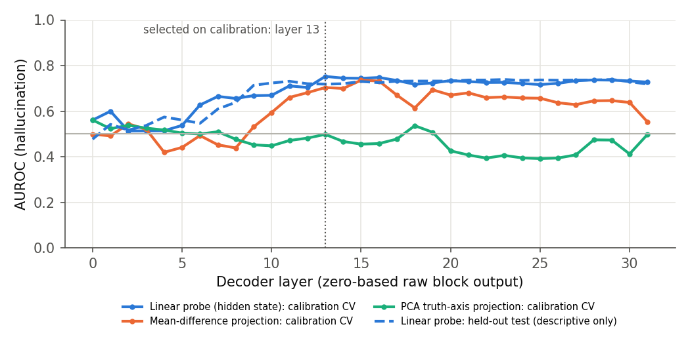
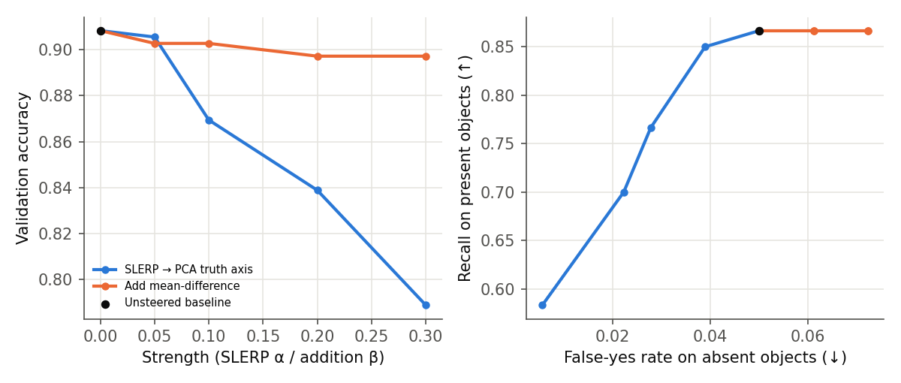

# CounterPrior results

Run `a57da9f4810959cc` · adapter `llava` · `llava-hf/llava-1.5-7b-hf` @ `b234b804b114d9e37bb655e11cbbb5f5e971b7a9` · quantization `4bit` · profile `quick` · seed 20261030.
Images per partition (calibration / validation / test): 40 / 20 / 100. CIs: 95% percentile bootstrap over images (1000 resamples), conditional on frozen calibration/validation choices.

Generated by `scripts/make_report.py` from saved run files only.

## 1. POPE baseline on held-out test images

| POPE split | Questions (images) | Accuracy | Precision | Recall | F1 | Yes-ratio |
|:---|:---:|:---:|:---:|:---:|:---:|:---:|
| random | 600 (100) | 0.882 [0.860, 0.905] | 0.971 [0.950, 0.988] | 0.787 [0.743, 0.827] | 0.869 [0.842, 0.897] | 0.405 [0.382, 0.428] |
| popular | 600 (100) | 0.865 [0.840, 0.890] | 0.933 [0.900, 0.963] | 0.787 [0.743, 0.827] | 0.854 [0.823, 0.882] | 0.422 [0.397, 0.447] |
| adversarial | 600 (100) | 0.843 [0.815, 0.872] | 0.887 [0.852, 0.922] | 0.787 [0.743, 0.827] | 0.834 [0.803, 0.865] | 0.443 [0.418, 0.470] |
| pooled | 1800 (100) | 0.863 [0.840, 0.888] | 0.929 [0.905, 0.951] | 0.787 [0.743, 0.827] | 0.852 [0.824, 0.880] | 0.423 [0.400, 0.447] |

Baseline on every selected image (no tuning involved, so comparable to published POPE numbers)

| POPE split | Questions (images) | Accuracy | Precision | Recall | F1 | Yes-ratio |
|:---|:---:|:---:|:---:|:---:|:---:|:---:|
| random | 960 (160) | 0.884 [0.866, 0.902] | 0.972 [0.953, 0.988] | 0.792 [0.760, 0.823] | 0.873 [0.851, 0.894] | 0.407 [0.391, 0.424] |
| popular | 960 (160) | 0.869 [0.849, 0.887] | 0.936 [0.913, 0.960] | 0.792 [0.760, 0.823] | 0.858 [0.835, 0.879] | 0.423 [0.404, 0.443] |
| adversarial | 960 (160) | 0.841 [0.820, 0.861] | 0.878 [0.851, 0.905] | 0.792 [0.760, 0.823] | 0.832 [0.809, 0.855] | 0.451 [0.431, 0.472] |
| pooled | 2880 (160) | 0.865 [0.845, 0.883] | 0.927 [0.909, 0.945] | 0.792 [0.760, 0.823] | 0.854 [0.832, 0.875] | 0.427 [0.410, 0.444] |

## 2. Hallucination detection on test images

Target: `error` (1 = baseline answer was wrong). Layers for the three hidden-state detectors were chosen by image-grouped K-fold AUROC on calibration images only; the logit baselines need no fitting.

| Detector | Layer | Test AUROC | Test AUPRC |
|:---|:---:|:---:|:---:|
| Linear probe (hidden state) | 13 | 0.719 [0.667, 0.769] | 0.268 [0.208, 0.349] |
| Mean-difference projection | 15 | 0.783 [0.745, 0.823] | 0.320 [0.250, 0.411] |
| PCA truth-axis projection | 0 | 0.584 [0.522, 0.641] | 0.175 [0.133, 0.227] |
| Answer-token −log p | n/a (no fit) | 0.745 [0.683, 0.804] | 0.350 [0.266, 0.448] |
| Answer-token entropy | n/a (no fit) | 0.745 [0.683, 0.804] | 0.347 [0.264, 0.447] |

Test questions: 1800; endpoint-positive: 246 (base rate 0.137, the AUPRC of a random detector).

Per POPE split (test AUROC):

| POPE split | Linear probe | Answer-token −log p |
|:---|:---:|:---:|
| random | 0.758 [0.698, 0.812] | 0.755 [0.685, 0.820] |
| popular | 0.724 [0.671, 0.779] | 0.747 [0.683, 0.808] |
| adversarial | 0.669 [0.618, 0.720] | 0.729 [0.667, 0.788] |

Solid: calibration cross-validated AUROC (used for selection). Dashed: per-layer test AUROC, shown for description only.

## 3. Steering on test images

Strength per method was the best validation accuracy on the grid; controls reuse the SLERP strength. Δ = method − baseline on the same questions, paired bootstrap. False-yes rate = "yes" about an absent object (object hallucination; lower is better). Recall on present objects and retention of baseline-correct answers are the utility check.

| Method | Strength | Accuracy | Δ accuracy | False-yes rate | Δ false-yes | Recall (utility) | Retention |
|:---|:---:|:---:|:---:|:---:|:---:|:---:|:---:|
| SLERP → PCA truth axis | 0.05 | 0.857 [0.832, 0.883] | -0.007 [-0.016, 0.002] | 0.053 [0.034, 0.074] | -0.007 [-0.016, -0.001] | 0.767 [0.723, 0.810] | 0.988 [0.979, 0.996] |
| Add mean-difference | 0.05 | 0.866 [0.842, 0.889] | 0.002 [-0.002, 0.008] | 0.062 [0.043, 0.084] | 0.002 [0.000, 0.006] | 0.793 [0.750, 0.833] | 0.999 [0.997, 1.000] |
| Control: random direction (SLERP) | 0.05 | 0.864 [0.841, 0.888] | 0.001 [0.000, 0.002] | 0.059 [0.040, 0.081] | -0.001 [-0.003, 0.000] | 0.787 [0.743, 0.827] | 1.000 [1.000, 1.000] |
| Control: shuffled-label axis (SLERP) | 0.05 | 0.859 [0.833, 0.884] | -0.004 [-0.012, 0.003] | 0.056 [0.037, 0.077] | -0.004 [-0.013, 0.000] | 0.773 [0.727, 0.817] | 0.992 [0.984, 0.998] |

Δ accuracy by POPE split:

| Method | random | popular | adversarial |
|:---|:---:|:---:|:---:|
| SLERP → PCA truth axis | -0.007 [-0.017, 0.002] | -0.008 [-0.018, 0.000] | -0.005 [-0.015, 0.005] |
| Add mean-difference | 0.002 [-0.003, 0.007] | 0.003 [0.000, 0.008] | 0.002 [-0.003, 0.007] |
| Control: random direction (SLERP) | 0.000 [0.000, 0.000] | 0.000 [0.000, 0.000] | 0.002 [0.000, 0.005] |
| Control: shuffled-label axis (SLERP) | -0.005 [-0.012, 0.002] | -0.005 [-0.012, 0.002] | -0.003 [-0.010, 0.005] |

Validation sweep (selection data):

| Method | Strength | Val. accuracy | Val. false-yes rate | Val. recall |
|:---|:---:|:---:|:---:|:---:|
| Baseline | 0 | 0.908 | 0.050 | 0.867 |
| SLERP → PCA truth axis | 0.05 (selected) | 0.906 | 0.039 | 0.850 |
| SLERP → PCA truth axis | 0.1 | 0.869 | 0.028 | 0.767 |
| SLERP → PCA truth axis | 0.2 | 0.839 | 0.022 | 0.700 |
| SLERP → PCA truth axis | 0.3 | 0.789 | 0.006 | 0.583 |
| Add mean-difference | 0.05 (selected) | 0.903 | 0.061 | 0.867 |
| Add mean-difference | 0.1 | 0.903 | 0.061 | 0.867 |
| Add mean-difference | 0.2 | 0.897 | 0.072 | 0.867 |
| Add mean-difference | 0.3 | 0.897 | 0.072 | 0.867 |

- SLERP → PCA truth axis: no strength on the grid beat the unsteered baseline on validation; the test row reports the best grid point anyway.
- Add mean-difference: no strength on the grid beat the unsteered baseline on validation; the test row reports the best grid point anyway.

## Provenance

- Status: `{"stages_done": ["baseline", "calibrate", "sweep", "test", "report"], "inference_executed": true, "last_update": "2026-11-01T16:08:47.990006+00:00"}`
- Timing probe: `0.7712941765785217` s/question
- POPE question-file sha256: `{"random": "ac25245170b975a5bdf9080b23fd431dfe6be458bc038259c1f4f09a6bef7994", "popular": "72c1a8ad45d0c13514f5f22598261df41d3b533854d29682e924db50ed8aa753", "adversarial": "420b3407db1fa9f1187a805dca41cb7b97fd91504e6c2179706188c107fb8ef8"}`
- Raw files: predictions.jsonl, detection_scores.jsonl, layer_scores_test.npz, selection.json, steering_plan.json, validation_sweep.json

## Registered hypothesis interpretation

| Question | Status | Finding |
|:---|:---:|:---:|
| detection | inconclusive | For the configured error target, the paired probe-minus-confidence AUROC difference is -0.027 [-0.085, 0.029]. |
| geometry | supported | Held-out PCA-projection AUROC is 0.584 [0.522, 0.641]; this does not establish a universal truth direction. |
| steering | inconclusive | SLERP false-yes delta is -0.007 [-0.016, -0.001]; recall delta is -0.020 [-0.037, -0.007] (recall 0.767 [0.723, 0.810]). A measured reduction comes with lower recall. Geometric superiority to both matched controls is inconclusive. No unqualified safety improvement is established. |

Paired false-yes differences (SLERP minus control; negative favours SLERP):

| Control | Paired difference [95% CI] |
|:---|:---:|
| random_direction | -0.006 [-0.014, 0.000] |
| shuffled_labels | -0.002 [-0.006, 0.000] |

